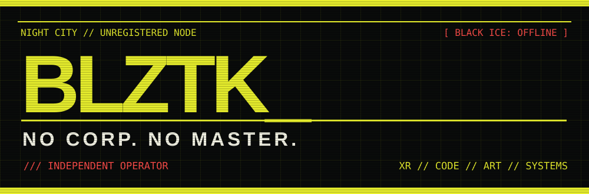
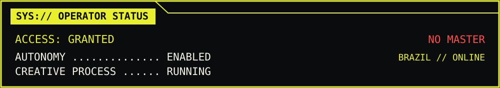

<div align="center">





**`[ UNREGISTERED SIGNAL ]`** &nbsp; **`[ INDEPENDENT OPERATOR ]`** &nbsp; **`[ SYSTEM ONLINE ]`**

</div>

---

## 🟡 `01 // IDENTITY BREACH`

```bash
root@nightcity:~# whoami
> BLZTK // independent creative developer

root@nightcity:~# cat /etc/mission
> Build experiences beyond the screen.
> Merge code, physical space, and human interaction.
> Break defaults. Stay curious. Own the tools.
```

Desenvolvo na interseção entre **software, arte e tecnologia imersiva**. Crio experiências com **Unity, Unreal Engine, VR/AR, visão computacional e creative coding** — especialmente para cultura, museus e interfaces experimentais.

## ⚡ `02 // CYBERWARE LOADOUT`

| SYSTEM | INSTALLED MODULES |
|:--|:--|
| 🟡 **IMMERSION** | Unity · Unreal Engine · Meta Quest · VR / AR / XR |
| 🔴 **PERCEPTION** | OpenCV · YOLO · Kinect · Computer Vision |
| 🟡 **CODE** | C# · C / C++ · Python · JavaScript · Rust |
| 🔴 **INTERFACE** | HTML · CSS · UI/UX · Interactive Web |
| 🟡 **EXPERIMENT** | TouchDesigner · Blender · Creative Coding |
| 🔴 **OPERATING SYSTEM** | Linux · Git · GitHub · Open Source |

## 🔴 `03 // ACTIVE OPERATIONS`

```text
╔════════════════════════════════════════════════════╗
║  [01] XR / IMMERSIVE WORLDS          [ ACTIVE ]     ║
║  [02] MUSEUMS / CULTURAL INTERFACES  [ ACTIVE ]     ║
║  [03] COMPUTER VISION / SENSORS      [ TESTING ]    ║
║  [04] INDEPENDENT CREATIVE TOOLS     [ BUILDING ]   ║
╚════════════════════════════════════════════════════╝
```

## 🟡 `04 // SOURCE CODE TRANSMISSIONS`

[**`>>> EXPLORE THE REPOSITORIES`**](https://github.com/BLZTK?tab=repositories)

No fake stats. No manufactured achievements. Just code, experiments and work in progress.

## 🔴 `05 // THE PROTOCOL`

> **NO CORP. NO MASTER.**  
> Technology should expand what people can create, explore and experience — not limit it.

---

<div align="center">

**`[ END OF TRANSMISSION ]`** · **`BLZTK_`** · **`BRAZIL`**

`// KEEP THE SIGNAL ALIVE //`

</div>
